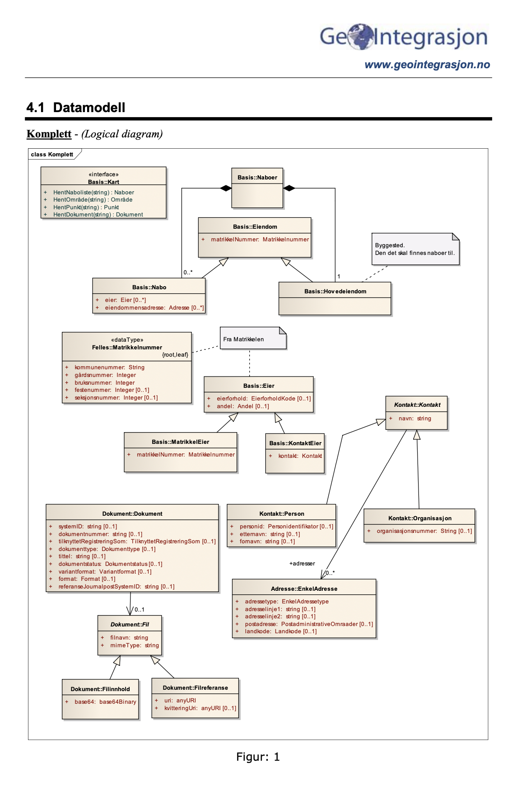
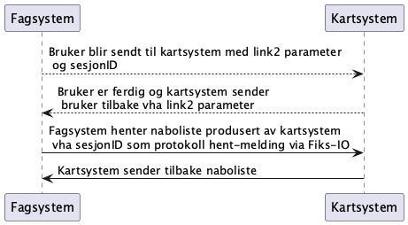
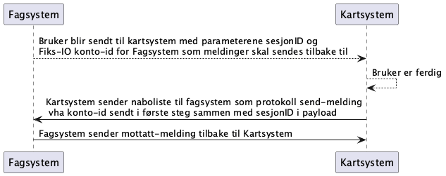
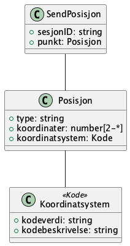
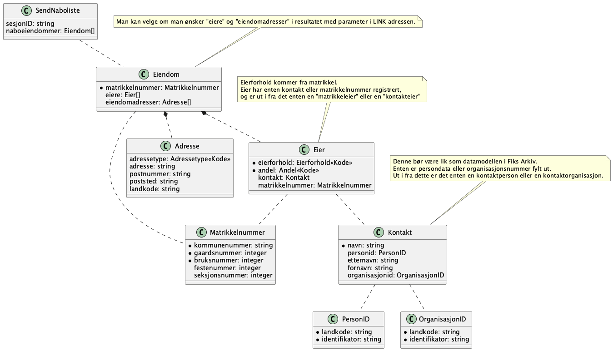
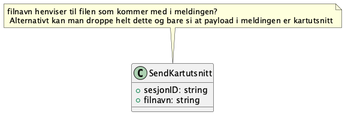
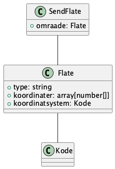

#  Kontrakter og dokumentasjon for Fiks Link
Dette er en fornyelse av GI Link vha blant annet Fiks Protokoll.

Link består av lenker som skal støttes av systemet som støtter Link.
Disse lenkene er webbaserte applikasjoner som klient-systemet kan bruke for f.eks. hente en naboliste basert på kartutsnitt. Så kan klienten hente listen etterpå via en tjeneste, som blir en Fiks Protokoll tjeneste. 

Link består altså av definerte lenker til systemet som fører til applikasjon som produserer noe, og tilhørende tjenester for å hente det applikasjonen produserte.  

## GI Link
https://geointegrasjon.no/link/

### GI Link UML
Hentet fra dokumentasjonen til GI Link:

## Fiks Link

_UNDER ARBEID_

Dette er utkast og under arbeid.

### Sekvensdiagram
#### GI Link - dialog mellom fagsystem og kartystem

Slik dialogen var i GI Link for tjenesten _hent naboliste_ og resten av tjenestene.
Kartsystemet sender bruker tilbake til angitt url i link2 parameter og venter på hent naboliste request før den returnerer resultat.

#### Fiks Link - dialog mellom fagsystem og kartystem

Slik vi ser for oss at dialogen blir i nye Fiks Link for tjenesten _lag naboliste_ og resten av tjenestene. 
Den store forskjellen er at linken (url med parametere) kartsystemet støtter ikke tar inn en link2 url som parameter, og i stedet sender melding tilbake med en gang til fagsystem med resultat.

### Linker

Link-tjenestene er tjenestene som enten viser noe eller som faktisk produserer noe i systemet.
Så vil karttjenesten levere resultatet til fagsystemet når bruker er ferdig.

#### LagNaboliste - send naboliste

Tjenesten gjør at brukeren kan etablere en liste over naboer for en gitt eiendom og returnere listen tilbake til opprinnelige system vha `no.ks.fiks.link.v1.innsyn.naboliste.send` melding.

System A (f.eks. sakssystemet) benytter funksjonen ved å kalle system B (vanligvis GIS) ved å benytte LINK. GIS-systemet åpnes med aktuelle eiendom i kartbildet og med forslag til naboer. Brukeren får kontroll i GIS-systemets funksjonalitet og bestemmer interaktivt hvilke eiendommer som skal inngå i listen. GIS-systemet lager listen og sendes resultatet tilbake ved meldingen SendNaboliste til angitt `kontoID`.

En kan benytte alle Vis-funksjoner for å zoome inn i kartet

##### Url - med eksempel
Parameterene sesjonID og kontoID er nødvendige for å vise hvilken sesjon data tilhører og hvilken konto melding skal sendes tilbake til. SesjonID legges til i meldingen som GIS-systemet sender tilbake.

http://www.system.no/side.html?funksjon=VisEiendom&kommunenummer=0123&gaardsnummer=1&bruksnummer=2&festenummer=0&seksjonsnummer=1&hint=LagNaboliste&sesjonID=A12345678901&kontoID=A12345678901&inkluderEiere=false&inkluderAdresse=false

**Parametere:**
- funksjon = VisEiendom
- kommunenummer
- gaardsnummer
- bruksnummer
- festenummer
- seksjonsnummer
- hint = LagNaboliste
- sesjonID
- kontoID
- inkluderEiere -> inkluder eiere i melding tilbake fra kartsystem
- inkluderAdresse -> inkluder adresser i melding tilbake fra kartsystem 

#### LagKartutsnitt - send kartutsnitt
Lager et kartutsnitt som så kartsystemet sender vha `no.ks.fiks.link.v1.innsyn.kartutsnitt.send` melding. Kartutsnittet kommer i form av et dokument.

Funksjon som aktiverer et annet system slik at brukeren kan få et kartsnitt rundt en gitt eiendom og returnere kartet som et dokument til sitt opprinnelige system.

System A (f.eks. SAK-systemet) benytter funksjonen ved å kommunisere med system B (vanligvis GIS).  GIS-systemet startes som LINK med parametrene som identifiserer aktuelle eiendom. Brukeren får kontroll i GIS-systemets funksjonalitet og bestemmer interaktivt kartutsnittets størrelse. GIS-systemet lager kartet og sender det tilbake til angitt `kontoID`.

En kan benytte alle Vis-funksjoner for å zoome inn i kartet

##### Url - med eksempel

http://www.system.no/side.html?funksjon=VisPlan&kommunenummer=0123&planidentifikasjon=R0118AP&hint=LagKartutsnitt&sesjonID=A12345678901&kontoID=123243245

**Parametere:**
- funksjon = VisPlan
- kommunenummer
- planidentifikasjon
- hint = LagKartutsnitt
- sesjonID
- kontoID

#### LagPunkt - send posisjon
Lager et punkt (`posisjon`) som så sendes vha `no.ks.fiks.link.v1.innsyn.posisjon.send` melding.

Vi har valgt å bruke det mer korrekte begrepet `posisjon` for datatypen som også brukes i andre protokoller.

Funksjon som aktiverer et GIS system slik at brukeren kan registrere en koordinat i kartbildet og kartsystemet returnerer et punktobjekt i melding til angitt `kontoID`

System A (f.eks. SAK-systemet) benytter funksjonen ved å kommunisere med system B (vanligvis GIS).  GIS-systemet overtar kontroll gjennom en LINK og brukeren angir et punkt i GIS systemet interaktivt. GIS-systemet lager koordinat lokalt og sender tilbake til angitt `kontoID`. 

En kan benytte alle Vis-funksjoner for å zoome inn i kartet

##### Url - med eksempel

http://www.system.no/side.html?funksjon=VisAdresse&kommunenummer=0123&adressenavn=Storgata&nummer=2&bokstav=A&hint=LagPunkt&sesjonID=A12345678901&kontoID=123145145

**Parametere:**
- funksjon = VisAdresse
- kommunenummer
- adressenavn
- nummer
- bokstav
- hint = LagPunkt
- sesjonID
- kontoID

#### LagOmraade - send flate
Lager et omraade (`flate`) som så sendes tilbake vha `no.ks.fiks.link.v1.innsyn.flate.send` melding. 
Vi har valgt å bruke det mer korrekte begrepet `flate` for datatypen som også brukes i andre protokoller.

Funksjon som aktiverer et GIS system slik at brukeren kan registrere et område i kartbildet og returnere et områdeobjekt til sitt opprinnelige system.

System A (f.eks. SAK-systemet) benytter funksjonen ved å kommunisere med system B (vanligvis GIS).  GIS-systemet overtar kontroll gjennom en LINK og brukeren angir et område i GIS systemet interaktivt. GIS-systemet lager koordinater og sender tilbake til angitt `kontoID`.

En kan benytte alle Vis-funksjoner for å zoome inn i kartet

##### Url - med eksempel

http://www.system.no/side.html?funksjon=VisEiendom&kommunenummer=0123&gaardsnummer=1&bruksnummer=2&festenummer=0&seksjonsnummer=1&hint=LagOmraade&sesjonID=A12345678901&kontoID=123124124

**Parametere:**
- funksjon = VisEiendom
- kommunenummer
- gaardsnummer
- bruksnummer
- festenummer
- seksjonsnummer
- hint = LagOmraade
- sesjonID
- kontoID

### Meldingstyper og skjema

Json schemas er forsøkt modellert etter UML diagrammer fra GI Link, men med endringer der hvor det har virket fornuftig

#### Meldingstyper / json schemas

- `no.ks.fiks.link.v1.innsyn.kartutsnitt.send.schema.json`
- `no.ks.fiks.link.v1.innsyn.naboliste.send.schema.json` 
- `no.ks.fiks.link.v1.innsyn.flate.send.schema.json`
- `no.ks.fiks.link.v1.innsyn.posisjon.send.schema.json`

#### Json schemas for datatyper brukt i meldingstypene

- `no.ks.fiks.link.v1.felles.adresse.schema.json` - Bør endres til slik som i Fiks Plan / Fiks Arkiv?
- `no.ks.fiks.link.v1.felles.eiendom.schema.json` 
- `no.ks.fiks.link.v1.felles.eier.schema.json` 
- `no.ks.fiks.link.v1.felles.flate.schema.json` - Kopiert fra Fiks Plan
- `no.ks.fiks.link.v1.felles.kontakt.schema.json`
- `no.ks.fiks.link.v1.felles.organisasjonid.schema.json`
- `no.ks.fiks.link.v1.felles.personid.schema.json`
- `no.ks.fiks.link.v1.felles.matrikkelnummer.schema.json` - Kopiert fra Fiks Plan
- `no.ks.fiks.link.v1.felles.posisjon.schema.json` - Kopiert fra Fiks Plan

### Send posisjon - resultat av LagPunkt

**Skjema for meldingstype:**
- [`no.ks.fiks.link.v1.innsyn.posisjon.send.schema.json`](Schema/V1/no.ks.fiks.link.v1.innsyn.posisjon.send.schema.json)

### Send naboliste - resultat av LagNaboliste

- [`no.ks.fiks.link.v1.innsyn.naboliste.send.schema.json`](Schema/V1/no.ks.fiks.link.v1.innsyn.naboliste.send.schema.json)

### Send kartutsnitt - resultat av LagKartutsnitt

**Skjema for meldingstype:**
- [`no.ks.fiks.link.v1.innsyn.kartutsnitt.send.schema.json`](Schema/V1/no.ks.fiks.link.v1.innsyn.kartutsnitt.send.schema.json)

### Send flate - resultat av LagOmraade

**Skjema for meldingstype:**
- [`no.ks.fiks.link.v1.innsyn.flate.send.schema.json`](Schema/V1/no.ks.fiks.link.v1.innsyn.flate.send.schema.json)

